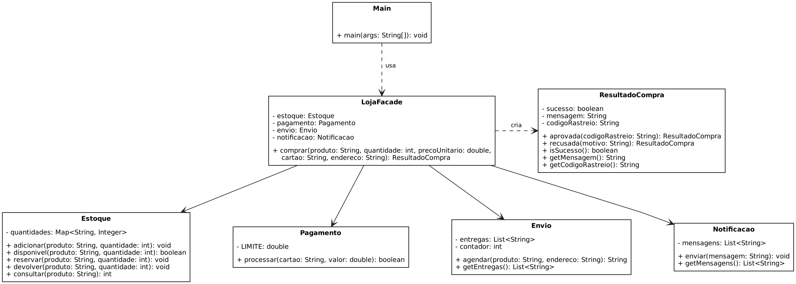

# Padrão Facade — Loja virtual

## O que o padrão resolve
Quando um sistema é formado por vários subsistemas (estoque, pagamento, envio, notificação), o cliente precisaria conhecer cada um deles e chamá-los na ordem certa. O **Facade** oferece uma interface única e simples que esconde essa complexidade: o cliente chama um só método e a fachada coordena o resto.

## Aplicação escolhida
Uma loja virtual. Para realizar uma compra, o cliente chama apenas `LojaFacade.comprar(...)`. Por trás, a fachada verifica o estoque, reserva os itens, processa o pagamento, agenda o envio e notifica o cliente. Se o pagamento é recusado, o estoque é devolvido.

## Estrutura do projeto
```
facade-pattern/
├── diagrama/diagrama-classes-facade.png
├── src/main/java/com/univassouras/facade/
│   ├── Estoque.java
│   ├── Pagamento.java
│   ├── Envio.java
│   ├── Notificacao.java
│   ├── ResultadoCompra.java
│   ├── LojaFacade.java
│   └── Main.java
├── src/test/java/com/univassouras/facade/LojaFacadeTest.java
├── pom.xml
└── .gitignore
```

## Papéis do padrão nesta implementação
| Papel no padrão | Classe |
|---|---|
| Facade | `LojaFacade` |
| Subsistemas | `Estoque`, `Pagamento`, `Envio`, `Notificacao` |
| Cliente | `Main` (usa somente a fachada) |
| Objeto de retorno | `ResultadoCompra` |

## Como executar
Requer JDK 17+ e Maven.
```
mvn compile exec:java -Dexec.mainClass="com.univassouras.facade.Main"
```

## Como rodar os testes
```
mvn test
```
Os 7 testes cobrem: compra válida (reserva de estoque e código de rastreio), agendamento da entrega e notificação ao cliente, compra sem estoque (sem cobrança, envio ou notificação), produto inexistente, cartão inválido (estoque devolvido e recusa notificada), valor acima do limite e códigos de rastreio sequenciais.

## Diagrama de classes


## Autor
Trabalho individual — disciplina Arquitetura e Projeto de Software.
